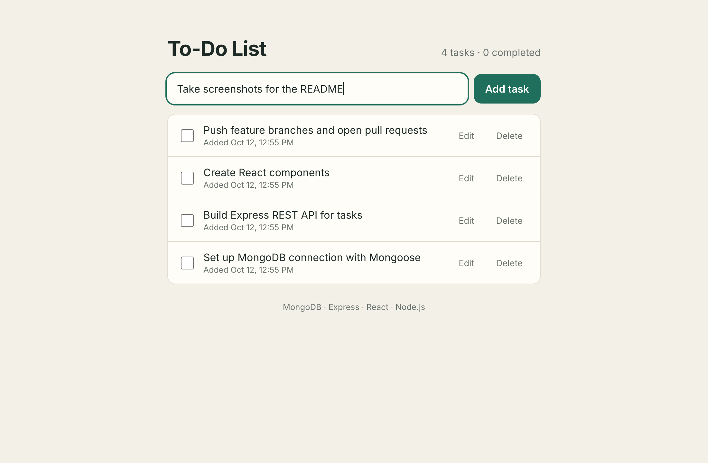
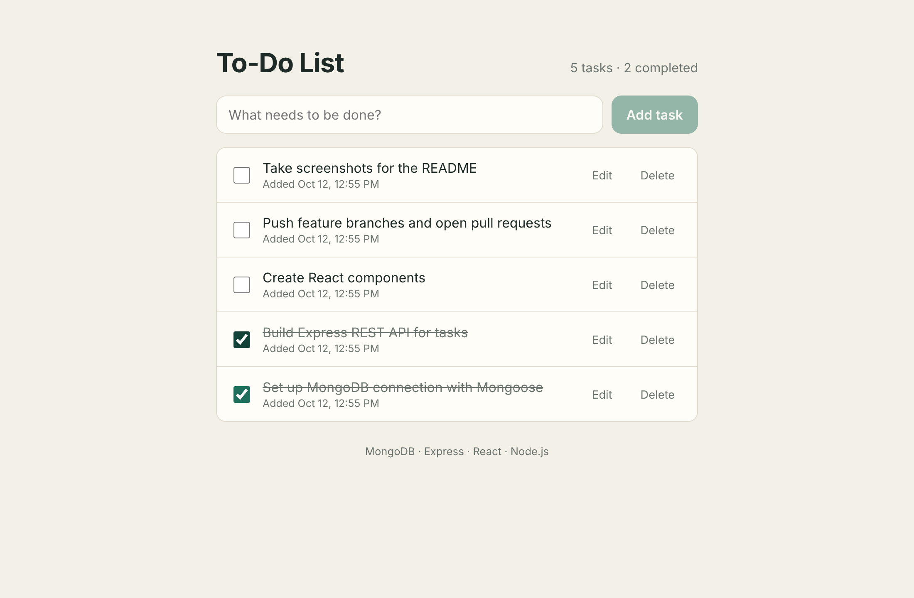
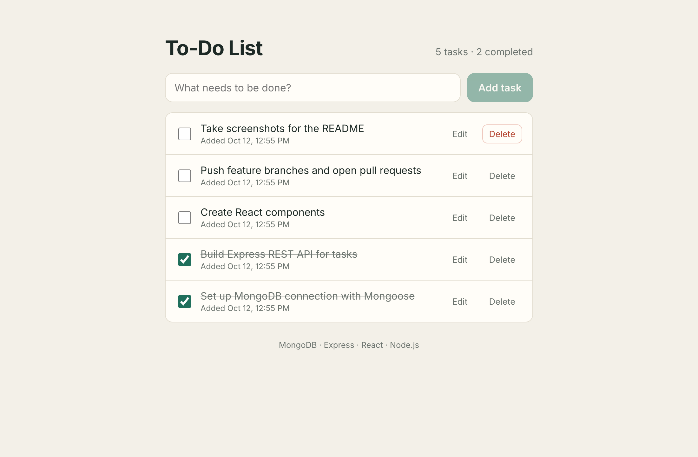
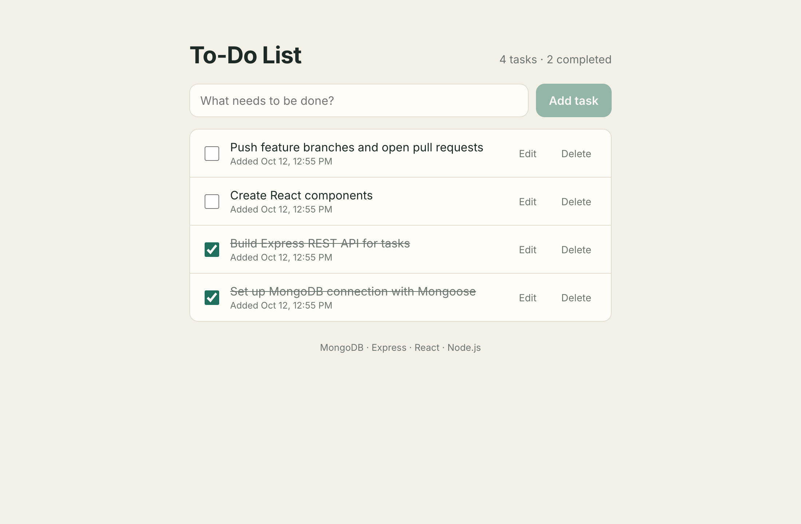

# MERN To-Do List

A full-stack To-Do List built with **MongoDB, Express.js, React and Node.js**.
Tasks are stored in MongoDB through a REST API, so they survive a page refresh — unlike the
`localStorage` version from the Module II lab.

23CSB40B Web Technology · Assignment 2 · MBCET

## Features

- Add a task (empty or whitespace-only titles are rejected)
- Mark a task complete / incomplete — completed tasks are struck through
- Edit a task's title (click **Edit** or double-click the title; Enter saves, Esc cancels)
- Delete a task
- Every action calls the backend and updates the screen without a page reload

## Project structure

```
mern-todo/
├── backend/                 Node.js + Express + Mongoose API
│   ├── config/db.js         MongoDB connection (reads MONGO_URI)
│   ├── models/Task.js       Task schema: title, completed, createdAt
│   ├── routes/tasks.js      GET / POST / PUT / DELETE /api/tasks
│   ├── server.js            Express app, CORS, JSON middleware
│   └── .env.example         Environment variable names (no real values)
├── frontend/                React app (Vite)
│   ├── src/api/tasks.js     fetch() helpers for each endpoint
│   ├── src/components/      TaskForm, TaskList, TaskItem
│   ├── src/App.jsx          State (useState) + initial load (useEffect)
│   └── .env.example
└── screenshots/
```

## Prerequisites

- Node.js 18 or newer
- MongoDB — either a local server or a free MongoDB Atlas cluster

## How to run

### 1. Backend

```bash
cd backend
npm install
cp .env.example .env      # then edit .env and set MONGO_URI
npm start
```

The API starts on **http://localhost:5050**. You should see `MongoDB connected` in the terminal.

Environment variables (`backend/.env`):

| Variable     | Example                                   | Purpose                              |
|--------------|-------------------------------------------|--------------------------------------|
| `MONGO_URI`  | `mongodb://127.0.0.1:27017/todo_app`      | MongoDB connection string (local or Atlas) |
| `PORT`       | `5050`                                    | Port for the Express server          |
| `CLIENT_URL` | `http://localhost:3000`                   | The only origin allowed by CORS      |

> Port 5050 is used instead of 5000 because macOS uses port 5000 for AirPlay Receiver.

### 2. Frontend (in a second terminal)

```bash
cd frontend
npm install
npm start
```

Open **http://localhost:3000**. The frontend must run on port 3000 because that is the only
origin the backend allows through CORS.

If your backend runs on a different address, create `frontend/.env` from `frontend/.env.example`
and change `VITE_API_URL`.

## REST API

Base URL: `http://localhost:5050/api/tasks`

| Method | Endpoint          | Body                                   | Success | Errors |
|--------|-------------------|----------------------------------------|---------|--------|
| GET    | `/api/tasks`      | —                                      | 200 + array of tasks | 500 |
| POST   | `/api/tasks`      | `{ "title": "Buy milk" }`              | 201 + created task   | 400 empty title |
| PUT    | `/api/tasks/:id`  | `{ "completed": true }` and/or `{ "title": "…" }` | 200 + updated task | 400 invalid body, 404 not found |
| DELETE | `/api/tasks/:id`  | —                                      | 200 + `{ message, id }` | 404 not found |

In POST and PUT the title is converted with `String()` and trimmed; an empty result is rejected
with **400**. Invalid or unknown IDs return **404**.

Quick test with curl:

```bash
curl -X POST http://localhost:5050/api/tasks -H "Content-Type: application/json" -d '{"title":"Test task"}'
curl http://localhost:5050/api/tasks
```

## Git workflow

- `main` holds the integrated, working application
- Backend developed on `feature/backend`, frontend on `feature/frontend`
- Each branch was merged into `main` through a pull request — no direct commits to `main`
- `.env` and `node_modules` are excluded by `.gitignore`; `.env.example` documents the variable names

## Screenshots

**Adding a task**



**Marking tasks complete** (strike-through)



**Deleting a task** — before and after




## Tech stack

MongoDB · Mongoose 8 · Express 4 · Node.js · React 19 · Vite · dotenv · cors
